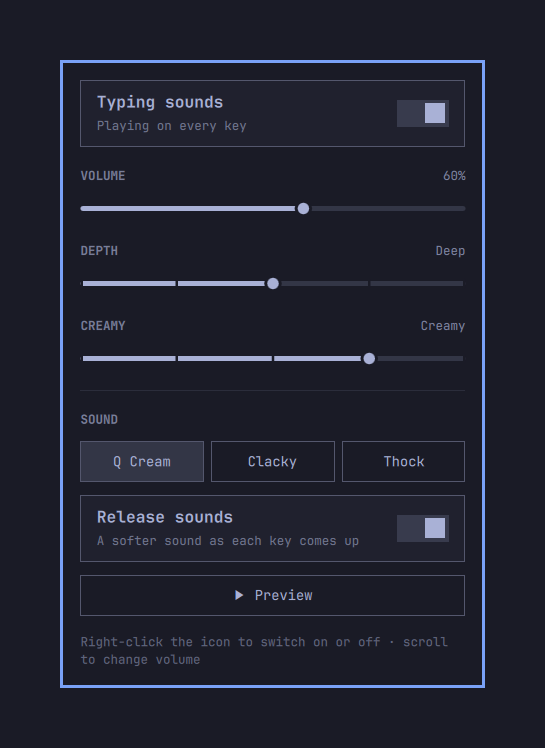

# Thock

Keychron Q-style keyboard sounds for Omarchy, without anything reading your keyboard.



## How it works

Hyprland already receives every keypress. `hypr/thock.lua` adds pass-through
bindings (`non_consuming`, `ignore_mods`) on the typing keys, matched by
physical position so any layout works. Each one fires a Hyprland global
shortcut: `thock:key`, `thock:space`, `thock:enter` or `thock:backspace`.
A global shortcut reports both edges of a key, so `Service.qml`, running
inside omarchy-shell, plays a downstroke when it's pressed and a softer
upstroke when it's released, using Qt's `SoundEffect`.

So:

- no process opens `/dev/input`, and you don't need the `input` group;
- the shell only learns "a key went down/up" and which of four sound groups
  it was, never which key, so it can't reconstruct what you type;
- keys still reach your apps exactly as before, and existing shortcuts are
  unaffected, because Hyprland runs every matching binding;
- nothing plays on the lock screen (the bindings aren't `locked`), or in apps
  that inhibit compositor shortcuts, such as VMs and remote desktops.

## Use

Click the keyboard icon in the bar to open the panel:

- **Typing sounds**: on or off;
- **Volume**: a preview plays when you let go of the slider;
- **Depth**: five steps from Brightest to Deepest, previewed the same way;
- **Creamy**: five steps from Crisp to Creamiest, where Natural is the
  profile as tuned and Creamy is the default;
- **Sound**: Q Cream, Clacky or Thock, switched live with a preview;
- **Release sounds**: the softer sound as each key comes back up;
- **Preview**: plays a few keys, even while sounds are off.

Shortcuts on the icon: right-click switches sounds on or off, and scrolling
changes the volume. In the open panel, Left/Right change the volume, Enter
switches sounds on or off, and Esc closes it.

Settings live in `~/.local/state/omarchy/thock.json`.

## Sounds

The samples are synthesized by `tools/make-sounds.py`, which uses only the
Python standard library. It writes every profile at every Depth and Creamy
step to `sounds/<profile>/depth<0-4>-cream<0-4>/`: 75 small sets, about
10 MB in all, so both sliders switch instantly.

- Depth mostly lowers the body and case thump, and only slightly darkens the
  texture above it, so that deep settings still come through laptop
  speakers.
- Creamy softens the attack, quiets the click, darkens the tone, lengthens
  the impact, and fades out overtones, case ring and stabilizer rattle. From
  Smooth upwards it also swaps the impact's noise, which always carries a
  little hiss and grain, for smooth damped tones. That's the buttery part. Darkening stops at Creamy, so Creamiest
  is smoother without being any quieter on laptop speakers.

Every sample is dry: no setting adds a ringing tail or room sound. Resonant
tails are damped, a gate clamps each sound shut a few milliseconds after
the hit, and each sample is cut off once it drops below -40 dB.

Profiles:

- `q-cream` (Q Cream, default): a Keychron Q-series with creamy, lubed linear
  switches, with a slow, rounded attack, almost no click, a smooth dark
  impact, a deep body over a strong aluminium-case thump, no ring, quiet
  stabilizers and a soft top-out;
- `keychron` (Clacky): brighter and poppier, like tactile switches with PBT
  caps, with a crisp clack, a faint case ring and a clicky upstroke;
- `thock` (Thock): a low, muted knock with no upstroke.

After editing the script, rebuild and restart the shell, which caches samples:

```bash
python3 tools/make-sounds.py           # or name profiles: q-cream keychron
omarchy restart shell
```

Edits to `Service.qml` also need `omarchy restart shell`; the shell keeps a
running service across plugin hot reloads.

## Install

```bash
omarchy plugin add https://github.com/TylerSw1ft/omarchy-thock.git --enable
```

That installs it to `~/.config/omarchy/plugins/tylersw1ft.thock/` and puts the
icon in the bar. The key bindings live in Hyprland's config, so add this to
the end of `~/.config/hypr/hyprland.lua`:

```lua
-- Thock typing sounds (Omarchy plugin tylersw1ft.thock). Skipped if the plugin is removed.
local thock_binds = (os.getenv("HOME") or "") .. "/.config/omarchy/plugins/tylersw1ft.thock/hypr/thock.lua"
local thock_file = io.open(thock_binds, "r")
if thock_file then
  thock_file:close()
  dofile(thock_binds)
end
```

Update later with `omarchy plugin update tylersw1ft.thock`.

## Install pieces

- Plugin: `~/.config/omarchy/plugins/tylersw1ft.thock/`, enabled with
  `omarchy plugin enable tylersw1ft.thock right`.
- Bindings: a guarded `dofile` at the end of `~/.config/hypr/hyprland.lua`,
  which is skipped if this folder is gone.

## Remove

```bash
omarchy plugin disable tylersw1ft.thock
rm -r ~/.config/omarchy/plugins/tylersw1ft.thock ~/.local/state/omarchy/thock.json
```

Then delete the "Thock typing sounds" block from `~/.config/hypr/hyprland.lua`.
